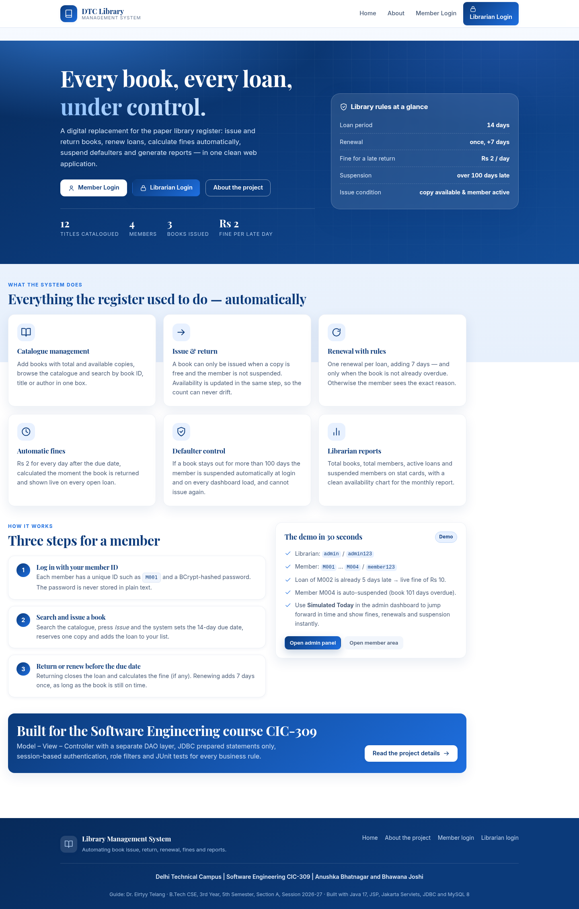
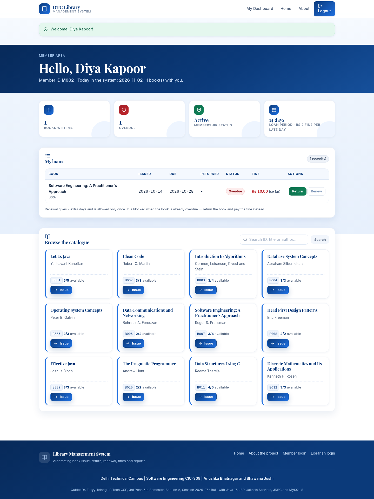
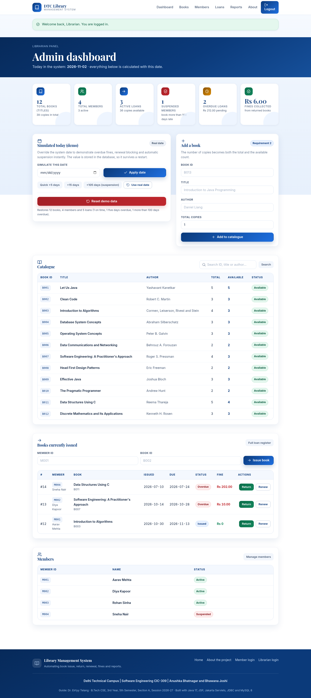
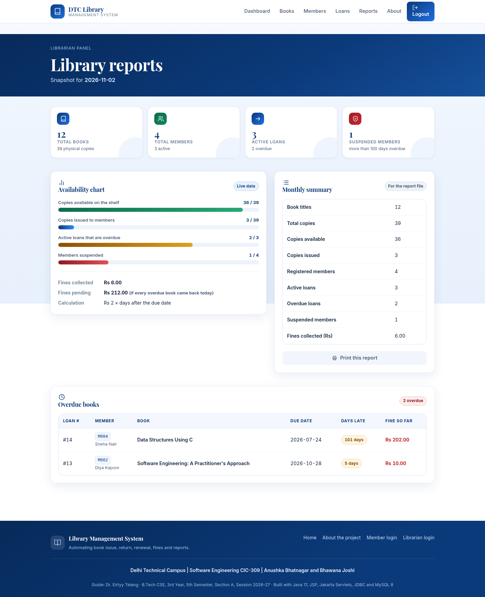
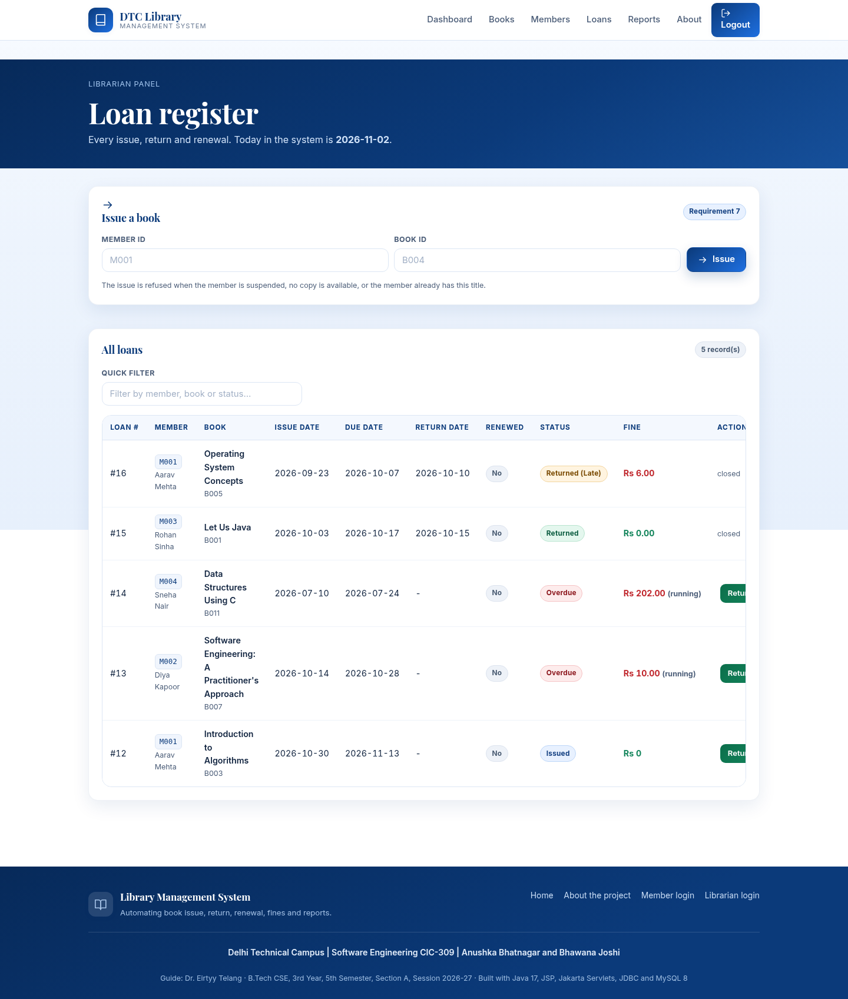
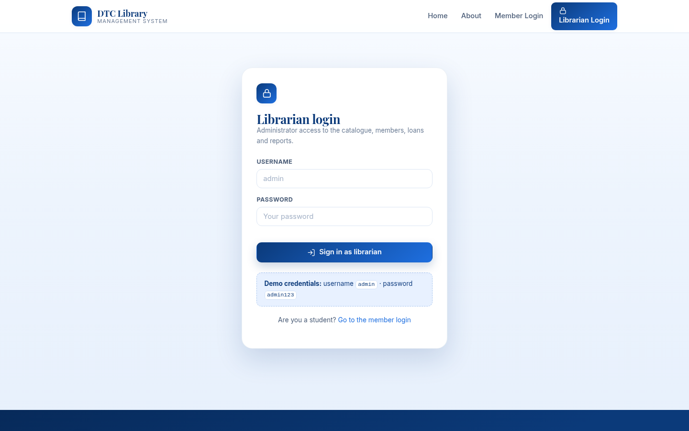

# Library Management System

**A complete web application that replaces the paper library register** — book issue, return and
renewal, automatic fine calculation, automatic suspension of defaulters and librarian reports.

> **Software Engineering (CIC-309) project**
> Delhi Technical Campus, Greater Noida · B.Tech CSE, 3rd Year, 5th Semester, Section A · Session 2026-27
> **Team:** Anushka Bhatnagar (04118002724) and Bhawana Joshi (04218002724)
> **Guide:** Dr. Eirtyy Telang


---

## 1. What this project does

The college library used to record every issue and return in a paper register. Answering a simple
question — *who has this book, when is it due, how much fine is pending, who is a defaulter?* — meant
searching pages by hand.

This system stores the whole register in MySQL and gives the librarian a dashboard plus a member
portal. Two roles:

| Role | Who | Can do |
|------|-----|--------|
| **Librarian (Admin)** | Library staff | Add books, register members, issue/return/renew any loan, see all members and loans, read reports, use the demo date control |
| **Member** | Student / faculty | Log in, browse and search the catalogue, issue a book for themselves, return or renew their own loans, see their fine and status |

---

## 2. Screenshots

All screenshots in this folder were captured from the running application (data from the demo seed).

| Home page | Member dashboard |
|---|---|
|  |  |

| Admin dashboard | Reports |
|---|---|
|  |  |

| Loan register | Login page |
|---|---|
|  |  |

More: [`docs/screenshots/`](docs/screenshots) —
home, logins, admin dashboard, books, members, loans, reports, member dashboard (desktop + mobile), about, 404.

---

## 3. Features (all 15 requirements implemented)

| # | Requirement | Where it lives |
|---|-------------|----------------|
| 1 | Admin login (`admin` / `admin123`, hint shown on the login page) | `LoginServlet`, `AuthService`, `AppConfig` |
| 2 | Add book (ID, title, author, copies; total = available) | `BookServlet`, `BookService.addBook` |
| 3 | View all books with total and available copies | `/admin/books`, `BookDAO.findAll` |
| 4 | Search a book by ID (also by title/author) | `BookDAO.search`, search boxes on both dashboards |
| 5 | Register member (unique ID, name, password) | `MemberServlet`, `AuthService.registerMember` |
| 6 | Member login | `LoginServlet`, `AuthService.loginMember` |
| 7 | Issue book (only if available > 0 and member not suspended; available − 1) | `CirculationService.issueBook` |
| 8 | View my loans (issue date, due date, status, fine) | `/member/dashboard`, "My loans" table |
| 9 | Return book (fine calculated, loan closed, available + 1) | `CirculationService.returnBook` |
| 10 | Renew book (not overdue, not renewed before, +7 days, otherwise show the reason) | `CirculationService.renewBook` |
| 11 | Fine = Rs 2 × overdue days | `FineService` |
| 12 | Auto-suspend a member whose unreturned book is > 100 days overdue (checked at login and on dashboard load); suspended members cannot issue | `CirculationService.refreshSuspension` |
| 13 | Reports: total books, members, active loans, suspended members (stat cards + chart) | `/admin/reports`, `ReportService` |
| 14 | Persistent storage in MySQL | `sql/schema.sql`, all `Jdbc*DAO` classes |
| 15 | Navigation: home, logout, back to menu on every page | `includes/header.jsp`, `includes/footer.jsp` |

Extra quality features:

* **Server-side validation** on every form (`Validators`) **and** client-side validation (`js/app.js`).
* **BCrypt password hashing** — passwords are never stored in plain text.
* **Prepared statements only** — no SQL injection, no string concatenation of SQL.
* **Role-based filter** (`AuthFilter`) — `/admin/**` only for the librarian, `/member/**` only for members.
* **Post/Redirect/Get** with flash messages — refreshing a page never repeats an action.
* **Custom 404 and 500 pages** — a stack trace is never shown to the user.
* **JUnit 5 tests** for fines, suspension, issue, return, renew, duplicate IDs and login.

---

## 4. Business rules (one place: `util/AppConfig.java`)

| Rule | Value |
|------|-------|
| Loan period | **14 days** |
| Renewal | once per loan, **+7 days**, only if the book is not overdue |
| Fine | **Rs 2 per day** after the due date |
| Suspension | unreturned book **more than 100 days** overdue |
| Issue condition | at least one copy available **and** member status ACTIVE |

Because all five values are constants in `AppConfig`, the rules can be changed without touching any
service, DAO, JSP or test.

---

## 5. Technology stack

| Layer | Technology |
|-------|-----------|
| Language | Java 17 |
| Web | JSP 3.1 + JSTL 3.0, Jakarta Servlet 6.0 |
| Database access | JDBC with `PreparedStatement`, HikariCP connection pool |
| Database | MySQL 8.0 |
| Server | Apache Tomcat 10.1 (WAR deployment) |
| Build | Maven (WAR packaging) |
| Security | BCrypt (`jbcrypt`), session-based auth, role filter |
| Front end | HTML5, CSS3 (custom, responsive, no framework), vanilla JavaScript, inline SVG icons |
| Testing | JUnit 5 (Jupiter 5.10) |
| Deployment | Docker / Docker Compose |
| Version control | Git and GitHub |

No Spring, no ORM — deliberately, so that every layer can be explained in the viva.

---

## 6. Architecture (MVC + DAO)

```
Browser
   │  HTTP request
   ▼
Utf8Filter  →  AuthFilter            (encoding, then role check)
   │
   ▼
Controller (Servlet)                  reads the request, calls a service, picks a view
   │
   ▼
Service                               business rules: fines, suspension, issue/return/renew
   │
   ▼
DAO (interface → JDBC implementation) SQL only, PreparedStatement
   │
   ▼
MySQL 8                               books, members, loans, app_settings
   │
   ▼
JSP + JSTL view                       renders HTML with the shared header/footer
```

### Folder structure

```
library-management-system/
├── pom.xml                        Maven build (WAR)
├── Dockerfile                     multi-stage build → Tomcat 10.1 image
├── docker-compose.yml             app + MySQL 8, schema and seed loaded automatically
├── .dockerignore
├── .gitignore
├── README.md
├── sql/
│   ├── schema.sql                 database + 4 tables, keys, constraints
│   └── seed.sql                   12 books, 4 members, 5 loans (relative to today)
├── docs/screenshots/              screenshots of the running application
└── src/
    ├── main/java/com/dtc/lms/
    │   ├── model/                 Book, Member, Loan, MemberStatus, Role
    │   ├── dao/                   BookDAO, MemberDAO, LoanDAO, SettingsDAO (interfaces)
    │   │   └── jdbc/              JdbcBookDAO, JdbcMemberDAO, JdbcLoanDAO, JdbcSettingsDAO
    │   ├── service/               AuthService, BookService, CirculationService, FineService,
    │   │                          ReportService, ClockService, DemoDataService, DashboardStats
    │   ├── controller/            HomeServlet, LoginServlet, LogoutServlet, BookServlet,
    │   │                          MemberServlet, CirculationServlet, ReportServlet, SettingsServlet
    │   ├── filter/                Utf8Filter, AuthFilter
    │   └── util/                  AppConfig, DBConnection, PasswordUtil, Validators, Flash,
    │                              SessionUtil, AppContextListener
    ├── main/webapp/
    │   ├── WEB-INF/web.xml        filter order, welcome file, session, error pages
    │   ├── WEB-INF/views/         home, about, logins, register, admin/*, member/*, error/*
    │   │   └── includes/          header.jsp, footer.jsp, icons.jsp (SVG sprite)
    │   ├── index.jsp              forwards "/" to the HomeServlet
    │   ├── css/style.css          design system (navy #0B3A7A, cards, badges, responsive)
    │   ├── js/app.js              navigation, validation, confirms, table filter
    │   └── images/                logo.svg, favicon.svg
    └── test/java/com/dtc/lms/     FineServiceTest, CirculationServiceTest, BookServiceTest,
                                   AuthServiceTest, PasswordUtilTest + in-memory DAO fakes
```

---

## 7. Database design

```
books                                  members
─────────────────────────              ─────────────────────────────
book_id           PK  VARCHAR(12)      member_id      PK  VARCHAR(12)
title                 VARCHAR(150)     name               VARCHAR(120)
author                VARCHAR(120)     password_hash      VARCHAR(100)  (BCrypt)
total_copies          INT              status             ENUM(ACTIVE, SUSPENDED)
available_copies      INT              created_at         TIMESTAMP
created_at            TIMESTAMP
      ▲                                       ▲
      │                                       │
      └──────────────┐        ┌───────────────┘
                     │        │
                   loans
                   ─────────────────────────────────────────────
                   loan_id      PK  INT AUTO_INCREMENT
                   member_id    FK  → members(member_id)
                   book_id      FK  → books(book_id)
                   issue_date       DATE
                   due_date         DATE
                   return_date      DATE NULL
                   returned         BOOLEAN
                   renewed          BOOLEAN
                   fine             DECIMAL(10,2)
```

`app_settings(setting_key PK, setting_value)` stores the demo "Simulated Today" date.

Constraints enforced by MySQL itself: primary keys (duplicate book/member IDs are impossible),
foreign keys (a loan cannot point to a missing book), and `CHECK` rules
(`available_copies <= total_copies`, `fine >= 0`, `due_date >= issue_date`).

---

## 8. Run it with Docker (recommended, one command)

Requirements: Docker Desktop (or Docker Engine + Compose v2).

```bash
# from the project root
docker compose up --build
```

* MySQL 8 starts first, creates `library_db` and runs `sql/schema.sql` + `sql/seed.sql`.
* Tomcat 10.1 starts with the WAR deployed as the ROOT application.
* Open **http://localhost:8080**

Useful commands:

```bash
docker compose up -d          # start in the background
docker compose logs -f app    # follow the Tomcat log
docker compose down           # stop the containers
docker compose down -v        # stop and delete the database volume (fresh demo next time)
```

---

## 9. Run it without Docker (manual setup)

### 9.1 Install

| Software | Version |
|----------|---------|
| JDK | 17 or newer (`java -version`) |
| Maven | 3.8+ (`mvn -version`) |
| MySQL | 8.0 (`mysql --version`) |
| Tomcat | 10.1.x (`apache-tomcat-10.1.x`) |

### 9.2 Create the database

```bash
mysql -u root -p < sql/schema.sql
mysql -u root -p < sql/seed.sql
```

Optional dedicated user (matches the Docker defaults):

```sql
CREATE USER 'lms_user'@'localhost' IDENTIFIED BY 'lms_pass';
GRANT SELECT, INSERT, UPDATE, DELETE ON library_db.* TO 'lms_user'@'localhost';
FLUSH PRIVILEGES;
```

### 9.3 Build the WAR

```bash
mvn clean package
# -> target/library-management-system.war
```

`mvn clean package` also runs the 38 unit tests; they need **no** database, so the build always
passes on a clean machine.

### 9.4 Deploy to Tomcat

```bash
cp target/library-management-system.war "$CATALINA_HOME/webapps/ROOT.war"
"$CATALINA_HOME/bin/startup.sh"        # Windows: bin\startup.bat
```

Then open **http://localhost:8080**

### 9.5 Database settings

The application reads the connection from environment variables (`util/AppConfig.java`):

| Variable | Default | Meaning |
|----------|---------|---------|
| `DB_URL` | `jdbc:mysql://localhost:3306/library_db?useSSL=false&allowPublicKeyRetrieval=true&serverTimezone=UTC&characterEncoding=UTF-8` | JDBC URL |
| `DB_USER` | `root` | database user |
| `DB_PASSWORD` | `root` | database password |
| `DB_POOL_SIZE` | `10` | connection pool size |

Set them before starting Tomcat, for example:

```bash
export DB_URL="jdbc:mysql://localhost:3306/library_db?useSSL=false&allowPublicKeyRetrieval=true&serverTimezone=UTC"
export DB_USER="lms_user"
export DB_PASSWORD="lms_pass"
```

If your MySQL root account uses `root` as the password (the XAMPP/WAMP default is often an empty
password), either change `DB_PASSWORD` or create the `lms_user` account shown above.

---

## 10. Demo credentials

| Role | Username / ID | Password |
|------|---------------|----------|
| Librarian (Admin) | `admin` | `admin123` |
| Member | `M001` … `M004` | `member123` |

The demo data (`sql/seed.sql`) is dated relative to *today*, so it is always meaningful:

| Loan | Member | Book | State |
|------|--------|------|-------|
| 1 | M001 | Introduction to Algorithms | issued 3 days ago, due in 11 days — **on time** |
| 2 | M002 | Software Engineering (Pressman) | **5 days overdue → fine Rs 10** |
| 3 | M004 | Data Structures Using C | **101 days overdue → M004 auto-suspended** |
| 4 | M003 | Let Us Java | already returned, no fine |
| 5 | M001 | Operating System Concepts | already returned 3 days late, fine Rs 6 |

### "Simulated Today" — demo overdue behaviour in seconds

The admin dashboard has a **Simulated today (demo)** card. Whatever date you set there is stored in
`app_settings` and used by *every* screen, so you can jump forward in time:

1. Log in as `admin`.
2. Set the simulated date to **today + 15 days** → M001's loan becomes overdue and a fine starts
   growing; a **renew** is now refused with the reason.
3. Set it to **today + 105 days** → the panel marks members whose books passed 100 days as
   **SUSPENDED**, and those members can no longer issue.
4. **Use real date** clears the override; **Reset demo data** rebuilds the whole demo set.

An orange banner at the top of every page reminds you that a simulated date is active.

---

## 11. Tests

```bash
mvn test        # 38 unit tests, no database required
```

| Test class | What it proves |
|------------|----------------|
| `FineServiceTest` | 5 days late = Rs 10; on-time/early = Rs 0; 100 days ≠ suspended, 101 days = suspended; 14-day loan; +7-day renewal |
| `CirculationServiceTest` | issue reduces availability; no copies → refused; duplicate active loan → refused; suspended member cannot issue; return restores availability and charges the fine; double return refused; member cannot touch another member's loan; renewal +7 days once only; overdue renewal refused; auto-suspension at 101 days and release after return |
| `BookServiceTest` | new book starts fully available; duplicate book ID rejected; invalid input rejected; search by ID/title/author |
| `AuthServiceTest` | `admin`/`admin123` accepted; wrong password rejected; BCrypt hash stored; duplicate member ID rejected; suspension applied at login |
| `PasswordUtilTest` | hash/verify round-trip, random salt, and the demo hashes really belong to the demo passwords |

The DAOs are replaced by small in-memory fakes (`src/test/java/com/dtc/lms/support/`), which is why
the tests run without MySQL and finish in about a second.

---

## 12. Deployment to a free host

### Render (Docker + managed MySQL)

1. Push this repository to GitHub (steps in section 13).
2. On [render.com](https://render.com): **New → MySQL** (free tier), then copy the internal
   connection details.
3. **New → Web Service → Build from repository**, choose the repo:
   * Environment: **Docker** (Render detects the `Dockerfile`)
   * Health check path: `/home`
4. Add environment variables on the web service:

   | Key | Value |
   |-----|-------|
   | `DB_URL` | `jdbc:mysql://<host>:<port>/<database>?useSSL=false&allowPublicKeyRetrieval=true&serverTimezone=UTC` |
   | `DB_USER` | the MySQL user Render created |
   | `DB_PASSWORD` | its password |

5. Import `sql/schema.sql`, then `sql/seed.sql`, into that database (Render → MySQL → *Connect* →
   run the SQL from the web shell or any MySQL client).
6. Deploy. Render passes `PORT`, and the container rewrites Tomcat's connector to that port
   automatically, so the public URL works.

### Railway

1. **New Project → Deploy from GitHub repo** (Railway reads the `Dockerfile`).
2. **+ New → Database → MySQL** in the same project.
3. On the app service add `DB_URL`, `DB_USER`, `DB_PASSWORD` from the MySQL service's
   *Connect* tab, and expose port `8080` (or set `PORT`).
4. Import `sql/schema.sql` and `sql/seed.sql` with the Railway CLI or MySQL Workbench.
5. **Generate Domain** to get a public link.

### ⚠️ GitHub Pages cannot run this project

GitHub Pages only serves **static files** (HTML, CSS, JavaScript). This application is Java: the JSP
pages are compiled and executed on **Tomcat**, and the servlets talk to **MySQL**. GitHub Pages has
no JVM, no servlet container and no database, so the project cannot run there. GitHub is used only
for **source-code hosting**; deployment needs a Docker host such as Render or Railway (or a local
Tomcat installation).

---

## 13. Upload to GitHub

```bash
cd library-management-system
git init
git add .
git commit -m "Library Management System - CIC-309 project"
git branch -M main
git remote add origin https://github.com/<your-username>/library-management-system.git
git push -u origin main
```

`.gitignore` already excludes `target/`, the WAR file, IDE folders and log files, so only the sources
are committed.

---

## 14. Troubleshooting

| Symptom | Cause and fix |
|---------|---------------|
| 500 page saying the database is not reachable | MySQL is not running, or `DB_URL`/`DB_USER`/`DB_PASSWORD` are wrong. Check with `mysql -u <user> -p`. |
| `No suitable driver` in the log | The MySQL connector JAR is missing from `WEB-INF/lib`. Run `mvn clean package` (it is declared in `pom.xml`), do not copy classes by hand. |
| `Access denied for user` | The user has no grant on `library_db`. Re-run the `GRANT` statement in section 9.2. |
| Login says "Invalid member ID or password" for `M004` | Working as designed when the demo data is old: M004's book is more than 100 days overdue. Use **Reset demo data**. |
| Port 8080 already in use | Stop the other Tomcat/application, or change the port mapping in `docker-compose.yml` (`"8090:8080"`). |
| Docker: tables are empty | The init scripts run only when the MySQL volume is created for the first time: `docker compose down -v && docker compose up --build`. |
| JSP shows `${...}` literally | The JSTL JARs are missing — build with `mvn clean package`, do not deploy the exploded source folder. |

---

## 15. Known limitations

* The librarian is a single configuration-level account (`admin`) stored as a BCrypt hash in
  `AppConfig`, not a row in the database, so there is no "add another librarian" screen.
* Fines are stored as the amount due at the moment of return; there is no separate payment table
  (a payment module would be the next step).
* No e-mail / SMS reminders and no password-reset flow (the librarian sets the initial password).
* The "Simulated Today" override is a demo aid. It is global for the whole application, which is
  exactly what makes the viva demonstration fast.
* Single library branch, no reservations/queues for books that are fully issued.
* HTTP only: for a real deployment put the application behind a reverse proxy with HTTPS.

---

## 16. Future enhancements

Reservations and waiting lists · fine payment records and receipts · e-mail reminders before the due
date · search with pagination for very large catalogues · barcode/QR scanning · admin user management
with multiple librarians · monthly Excel/PDF report export.

---

## 17. Project information

| Item | Detail |
|------|--------|
| Subject | Software Engineering (CIC-309) |
| Institute | Delhi Technical Campus, Greater Noida |
| Course | B.Tech CSE, 3rd Year, 5th Semester, Section A |
| Session | 2026-27 |
| Guide | Dr. Eirtyy Telang |
| Team | Anushka Bhatnagar (04118002724), Bhawana Joshi (04218002724) |

Developed as an academic project. Free to study and reuse for learning purposes.
